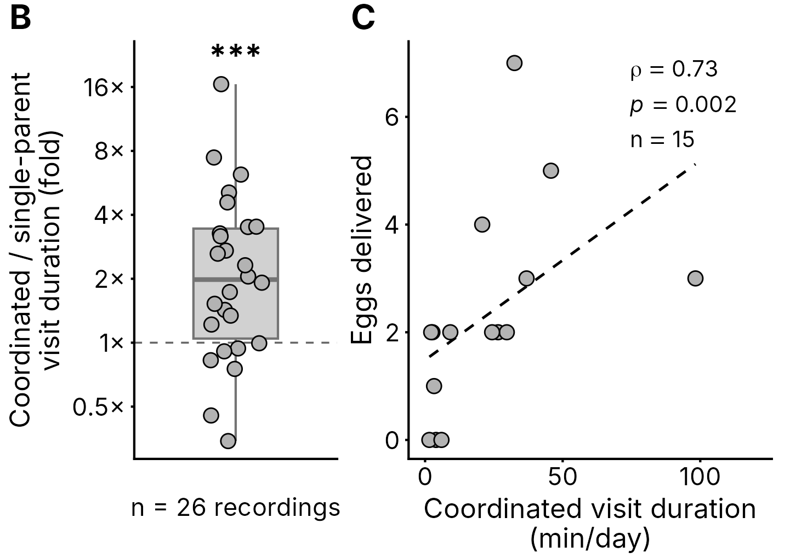
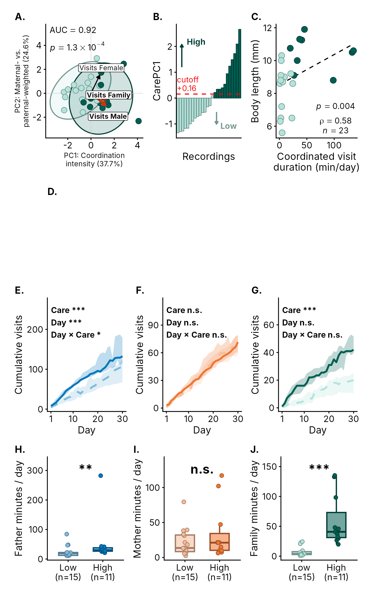
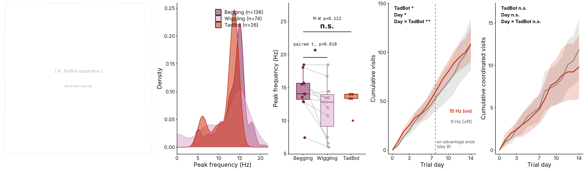
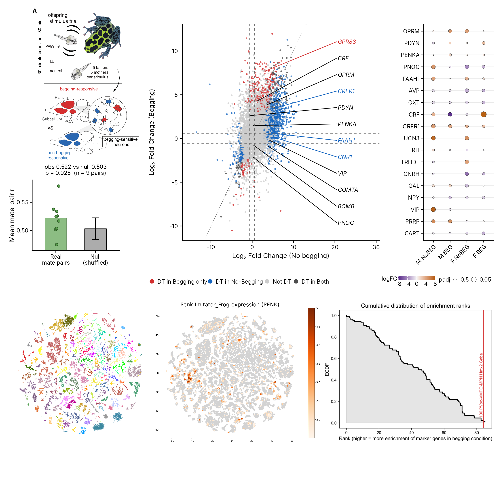
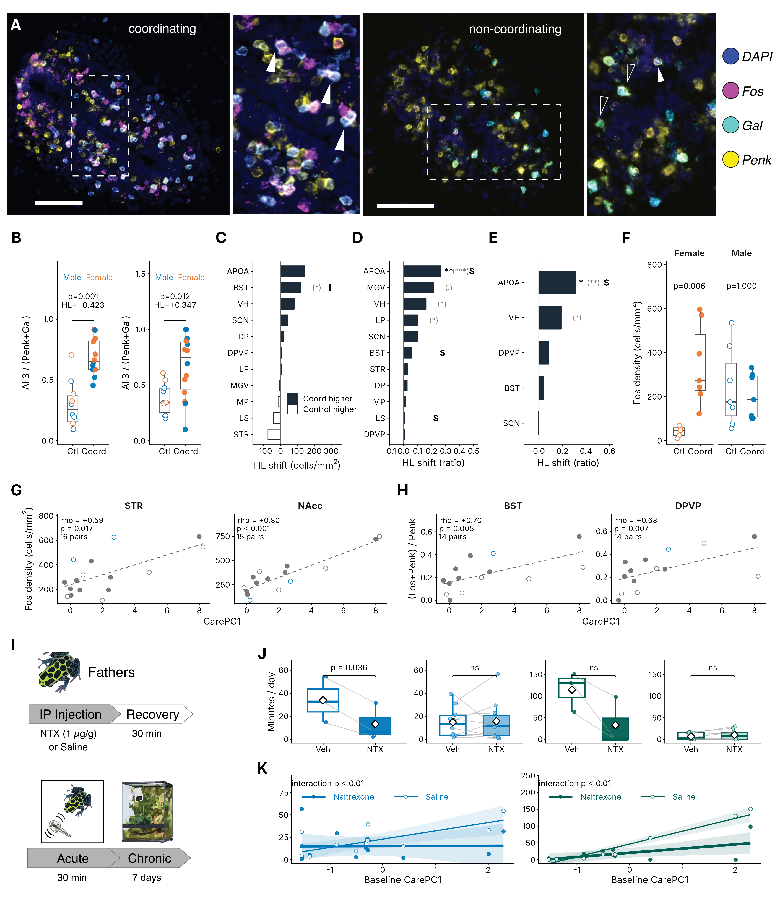

```{r}
#| label: setup
#| code-fold: false
library(here)    # every path starts from the folder that holds the .Rproj file
library(knitr)

# Each analysis step is one script in Functions/. run_step() runs a script in
# its own environment, exactly as Functions/run_all.R does.
run_step <- function(script) {
  source(here("Functions", script), local = new.env())
  invisible(NULL)
}

derived <- function(file) read.csv(here("Supplementary", "derived_tables", file), check.names = FALSE)

set.seed(1)   # every step that draws random numbers sets its own seed; see "Reproducibility"
```

```{r}
#| label: path-hook
#| include: false
# Print paths relative to the project folder, whichever computer renders this.
local({
  default_output <- knitr::knit_hooks$get("output")
  knitr::knit_hooks$set(output = function(x, options) {
    default_output(gsub(here::here(), ".", x, fixed = TRUE), options)
  })
})
```

## About this report {.unnumbered}

This page holds the analysis behind the quantitative panels of Figures 1 to 5. Rendering it runs every step from the files in `Data/` to the finished figures. The code for each step is folded under a "Code" heading; click it to read the script. The printed statistics and the figures below each step are the output of that run.

It does not contain the manuscript text. It also does not produce the panels drawn by hand (Figure 1A, Figure 3A) or the micrographs. Five finished images are placed into the figures by the scripts and are not drawn by them: the Figure 4A drawing, the three single-nucleus RNA-seq panels in the second row of Figure 4 (made in Python), the Figure 5 micrographs (panel A) and the Figure 5 naltrexone timeline (panel I).

The steps, in order:

| Step | Script in `Functions/` | Reads | Writes |
|---|---|---|---|
| 1 | `Figure1_ethogram_panels_11162026.R` | reference event logs, recording metadata | the table of nest visits; Figure 1 B, C |
| 2 | `Figure2_11162026.R` | the visit table, recording metadata | the CarePC1 index, care level and rule, the per-day care tables; Figure 2 |
| 3 | `Figure3_11162026.R` | begging-frequency workbooks, TadBot visit sheet, the CarePC1 rule | the TadBot tables; Figure 3 B to E |
| 4 | `Figure4_11162026.R` | phosphoTRAP tables, the Figure 4A drawing, the snRNA-seq images | the mate-pair synchrony tables; Figure 4 |
| 5 | `Figure5_11162026.R` | RNAscope image counts, RNAscope event logs and pair list, naltrexone visit sheet, the CarePC1 rule, the micrograph and timeline images | CarePC1 of the RNAscope pairs and of the naltrexone tanks, two statistics tables; Figure 5 |
| 6 | `check_results.R` | the derived tables | nothing; stops if a headline number has changed |

The scripts follow the order of the figures, and each one goes from the raw data to its finished figure. Two things are passed forward, so the order matters: Figure 1 writes the visit table that Figure 2 reads, and Figure 2 writes the CarePC1 rule that Figures 3 and 5 apply to their own cohorts. `shared_functions.R` holds what the figure scripts share: the event-log reading rules and the function that scores a cohort with the CarePC1 rule. Tables written along the way are saved in `Supplementary/derived_tables/` and figures in `Figures/`.

## Data

Everything is rebuilt from the files in `Data/`.

| Path in `Data/` | What it is | Used for |
|---|---|---|
| `event_logs/` | 26 spreadsheets, one per reference recording. Each row is one "In" or "Out" event at the nest: date, clock time, visitor (Male, Female, or Family = both parents), plus free-text notes. Typed by hand from video. | Figures 1, 2; defines CarePC1 |
| `recording_metadata.csv` | One row per reference recording; facts that cannot be worked out from the event logs (table below). | Figures 1, 2 |
| `begging_frequency/` | Peak frequency of tadpole begging, tadpole wiggling and the TadBot: one row per bout (`combinedbegginpeakfreq_v2.xlsx`, sheet `refined`) and one row per individual (`averagedbeggingpeaks.xlsx`). | Figure 3B, C |
| `tadbot/TadBot_posvnegctrl_v2.xlsx` | TadBot experiment. Sheet `raw_data` has one row per nest visit: tank, treatment (TadBot = 15 Hz, NegCtrl = 0 Hz), trial day, in and out times, visitor. The other sheets are earlier hand summaries and are not read. | Figure 3D, E |
| `pharmacology/opioid-behavior-spreadsheet.xlsx` | Naltrexone experiment. Sheet `rawdata` has one row per nest visit: tank, treatment (F = saline, E = naltrexone), day, visitor, minutes. The other sheets are earlier hand summaries and are not read. | Figure 5I to K |
| `phosphotrap/` | phosphoTRAP sequencing, already processed: edgeR tables of IP vs Input for the preoptic area (sexes combined, and each sex), the TMM-normalised expression matrix, and two sample sheets. | Figure 4B to D |
| `Analysis_ForBillie_Figure4/` | Single-nucleus RNA-seq: the three finished panel images the Figure 4 script places (`RI_sss_subclass_v5_10012026.png`, `Imitator_Frog_Penk_10012026.png`, `snRNAseq_enrichment_rank_ECDF.png`) and the four Jupyter notebooks (Python) from that analysis. The `.h5ad` expression files and the cell-type mapping tables the notebooks read are not included, so the notebooks cannot be rerun from this folder. | Figure 4, second row |
| `rnascope/Cleaned_Data_ForBillie_9-22-2026.csv` | RNAscope cell counts, one row per image: animal, brain region, counts of Fos, Penk, Gal and their combinations, area counted. | Figure 5B to H |
| `rnascope/event_logs/` | 18 event-log spreadsheets for the RNAscope breeding pairs, same layout as the reference recordings. | Figure 5G, H |
| `rnascope/rnascope_pairs.csv` | One row per RNAscope breeding pair: its two brain samples, its event log, and the number of days in its recording window. | Figure 5G, H |

The images placed into the figures are in `Figures/artwork/`: the Figure 2 photo strip (`Figure2_firstpanel_v2.png`), the Figure 4A drawing (`Figure4_artwork.png`), the Figure 5 micrographs (`Figure5_micrographs.png`) and the Figure 5 naltrexone timeline (`Figure5_naltrexone_timeline_stacked.png`).

Columns of `recording_metadata.csv`:

| Column | Meaning |
|---|---|
| `ObservationID` | Recording ID (breeding pair, then recording number) |
| `Pair` | Breeding pair |
| `NumberofFullDays` | Number of full days of usable video; the denominator for every per-day rate |
| `GapDays` | Recording days with no usable video, separated by `;`. Cumulative curves are left blank on these days. |
| `GapDaysNote` | The original hand-written note the gap days were read from |
| `EggFeedingEvents` | Number of egg-feeding events (15 recordings scored; blank = not scored) |
| `BodyLength_mm`, `TadpoleWeight_g`, `GosnerStage` | Tadpole measurements at the end of the recording |

`NumberofFullDays` and `GapDays` are the scorer's own record of each recording, made while the videos were scored. They are taken as given and are not re-derived from the event logs: a log does not always show whether a day without rows had no video or simply no visits, or whether a first or last day was a full day. In some recordings they therefore differ by a day or two from a date-by-date count of the log.

## Figure 1: coordinated visits

`Figure1_ethogram_panels_11162026.R` does everything for Figure 1. Its first part turns the 26 hand-typed event logs into one table with a row per nest visit; its second part draws panels B and C from that table.

### Part 1: from event logs to nest visits

1. **Choose the spreadsheets.** The 26 recording IDs are read from the metadata. A spreadsheet belongs to a recording if its file name starts with that ID (after an optional `done-`).
2. **Find the columns.** The spreadsheets do not share one layout, so each column is identified by what it contains: the status column mostly holds "In"/"Out", the visitor column mostly holds Male/Female/Family, the date column holds dates, the time column holds clock times, and the day column holds small whole numbers.
3. **Keep event rows.** A row is kept if it has a status, a date and a clock time. Header rows, blank rows and summary cells are dropped by this test.
4. **Read the visitor.** Short entries are read by their first letters, so spelling slips still count (`Mlae` is Male, `Femae` is Female, `Famly` is Family). Longer text in the visitor cell is treated as a note.
5. **Pair In with Out.** Rows stay in the order they were logged. Each "In" is paired with the next "Out" of the same visitor, and the visit's duration is the time between them. A second "In" before an "Out" replaces the first. An "Out" with no open "In" is skipped.
6. **Keep valid visits.** A visit is kept if it lasts at most 24 hours. Visits whose In and Out fall in the same minute are kept with a duration of 0: they count as visits, and analyses of log duration leave them out.

### Corrections applied while reading

The raw spreadsheets are never edited. Each correction is a rule in the code, and every row a rule touches is printed when the step runs (see "Rows touched by the correction rules" below).

| Typing slip | How it is detected | What the code does |
|---|---|---|
| Wrong year in a date | The year differs from the most common year in that recording (no recording spans New Year) | Moves the date to the recording's year |
| AM/PM slip (clock time typed 12 h early) | The row is more than 6 h earlier than a row above it with the same date, and adding 12 h gives the shortest positive visit | Adds 12 h to that row |
| Date not moved on after midnight | Same out-of-sequence test, but adding 24 h gives the shortest positive visit | Adds 24 h to that row |
| Note typed in the visitor cell of an Out row | The visitor cell is not a visitor, the row is an Out, and the row above is an open In | Treats the row as the Out for the visit opened above |
| Blank Day cell | The cell is empty | Fills the day from the date, using that recording's usual date-to-day offset |
| Visitor misspelt | First letters | Read as the intended visitor |

For out-of-sequence rows the code tries both shifts (12 h and 24 h) on each flagged row of the pair and keeps the shortest positive duration.

The reading and correction rules live in one file, used for both the reference recordings and the RNAscope recordings:

```{r}
#| file: Functions/shared_functions.R
#| eval: false
#| code-summary: "Code: Functions/shared_functions.R"
```

### Part 2: panels B and C

**Panel B: are coordinated visits longer than single-parent visits?** Visits with a duration above 0 are labelled Coord (visitor = Family) or Single (Male or Female). For each recording, the mean of log10(duration) is taken separately for the two types; their difference is that recording's log fold difference (the ratio of geometric mean durations). A Wilcoxon signed-rank test asks whether the 26 differences sit above zero, with the matched-pairs rank-biserial correlation as the effect size.

**Panel C: do pairs that spend longer in coordinated visits feed more eggs?** For the recordings scored for egg feeding, x is total coordinated-visit minutes divided by full recording days, y is the number of egg-feeding events, and the statistic is Spearman's rank correlation.

```{r}
#| file: Functions/Figure1_ethogram_panels_11162026.R
#| eval: false
#| code-summary: "Code: Functions/Figure1_ethogram_panels_11162026.R"
```

::: {.callout-note collapse="true" title="Console output of the Figure 1 script: rows touched by the correction rules, visit counts, panel statistics"}
```{r}
#| label: figure1
#| code-fold: false
run_step("Figure1_ethogram_panels_11162026.R")
```
:::

Visits in the table:

```{r}
#| label: step1-summary
#| code-summary: "Code: visit counts"
visits <- derived("VisitDurations_byType_derived_v4.csv")
visitor_col <- names(visits)[sapply(visits, function(x) all(c("Male", "Female", "Family") %in% x))][1]
counts <- as.data.frame(table(Visitor = visits[[visitor_col]]), responseName = "Visits")
counts$Visitor <- c(Family = "Coordinated (both parents)", Female = "Mother alone", Male = "Father alone")[as.character(counts$Visitor)]
kable(rbind(counts, data.frame(Visitor = "All", Visits = nrow(visits))), format.args = list(big.mark = ","))
```

{width=75%}

## Figure 2: the CarePC1 coordination index, care level and each parent's care

`Figure2_11162026.R` does everything for Figure 2. Its first half turns the visit table into per-day care rates, an index of coordinated care (CarePC1) and a High or Low care level for each recording; its second half draws the panels from the same objects.

### Part 1: from six care rates to CarePC1 and High/Low care

1. **Six per-day care rates.** For each recording and visitor (father alone, mother alone, coordinated), visits are counted and minutes summed, then divided by the number of full recording days. For these rates only, single-parent visits longer than 6 hours are left out; coordinated visits are always kept.
2. **Six-metric PCA.** A first look at how recordings differ across all care. Each of the six rates is turned into a z-score across the 26 recordings and a PCA is run on all six.
3. **CarePC1, the coordination index.** Coordinated visits lead the six-metric PC1, but father visits load almost as heavily, so that axis mixes coordination with each parent's solo care. To keep solo care free to be tested against coordination (Figure 2) and against naltrexone (Figure 5), the index uses the two coordinated rates only. Coordinated visits per day and coordinated minutes per day are each turned into a z-score, and CarePC1 is their first principal component, signed so that a higher score means more coordination. With two standardized variables this is (z of visits + z of minutes) divided by the square root of 2.
4. **Care level.** K-means with two clusters on CarePC1. The higher cluster is "High", the other "Low". The cutoff is halfway between the highest Low and the lowest High.
5. **Cumulative visits by day, and totals.** Per recording and visitor, visits are counted per recording day and accumulated; gap days are left blank. All visits are used here (no 6-hour filter), and the same is true of the minutes per day drawn in panels H to J.

### Part 2: the panels

| Panel | What it shows | Test |
|---|---|---|
| A | PCA of the six per-day care rates, recordings colored by care level | High vs Low on PC1: Wilcoxon rank-sum, AUC |
| B | CarePC1 per recording, ranked, with the k-means cutoff | none |
| C | Tadpole body length vs coordinated minutes per day | Spearman |
| D | A blank row for the photos of the three visit types (father only, mother only, coordinating), one heading each column below | none |
| E, F, G | Fathers, mothers, coordinated visits: cumulative visits over 30 days by care level (solid = High, dashed = Low) | Negative-binomial mixed model on daily visit counts |
| H, I, J | Fathers, mothers, coordinated visits: minutes per day by care level | Wilcoxon rank-sum |

By default the script leaves row D blank for the photos to be placed by hand. With `SHOW_PHOTOS <- TRUE` it draws them itself from `Figures/artwork/Figure2_firstpanel_v2.png`. The mixed model is `visits per day ~ care level + day + (1 + day | recording)`, negative-binomial; the day × care term is tested in a second model that adds the interaction. This step takes a minute or two.

```{r}
#| file: Functions/Figure2_11162026.R
#| eval: false
#| code-summary: "Code: Functions/Figure2_11162026.R"
```

```{r}
#| label: figure2
#| code-fold: false
run_step("Figure2_11162026.R")
```

{width=70%}

The numbers that define CarePC1 (means, SDs and loadings of the two coordinated rates, and the High/Low cutoff):

```{r}
#| label: step2-rule
#| code-summary: "Code: the CarePC1 rule"
kable(derived("CarePC1_rule.csv"), digits = 3)
```

Loadings of the six-metric PCA (panel A):

```{r}
#| label: step2-loadings
#| code-summary: "Code: six-metric PCA loadings"
kable(derived("CarePCA_sixMetrics_loadings.csv"), digits = 3)
```

### The same rule applied to the other cohorts

CarePC1 is defined once, on the 26 reference recordings. Every other cohort is scored with the stored means, SDs, loadings and cutoff, so High and Low mean the same thing in every figure. Each cohort is scored at the start of its own figure script: the TadBot tanks in the Figure 3 script, the naltrexone tanks and the RNAscope pairs in the Figure 5 script.

| Cohort | Unit | Days used | Output table |
|---|---|---|---|
| TadBot (Figure 3) | tank × treatment | trial days 1 to 3, divided by the number of those days recorded | `TadBot_first3days.csv`. The same step also writes `TadBot_dailyVisits.csv`: visits on each recorded trial day, days 1 to 14 (a day with no video has no row). |
| Naltrexone (Figure 5) | tank × treatment × visitor | 7 days per treatment; each tank's CarePC1 and care level come from its saline week. Single-parent visits longer than 6 h are left out, as for the reference recordings. Tank B16 (no parental visits) is left out. | `Pharmacology_perTank.csv` |
| RNAscope (Figure 5) | breeding pair | the recording window in `rnascope_pairs.csv` | `RNAscope_CarePC1_perPair.csv` |

The RNAscope event logs are read by the same code and the same correction rules as the reference recordings.

## Figure 3: tadpole begging and the TadBot

| Panel | What it shows | Test |
|---|---|---|
| B | Distribution of peak frequency for begging, wiggling and the TadBot | none |
| C | Mean peak frequency per individual | Begging vs wiggling: paired t-test; begging vs TadBot: Mann-Whitney |
| D | Cumulative parental visits over the 14 trial days, TadBot off (0 Hz) vs on (15 Hz): the mean visits per tank on each day, accumulated, ± 1 SE across tanks (jackknife). The dashed line marks the day on which the model's visits per day are equal in the two conditions | Negative-binomial mixed model on daily visits, `visits ~ TadBot × day + (1 | tank)` |
| E | The same for coordinated visits only | The same model on daily coordinated visits |

The script also prints two comparisons over the first three trial days alone (paired t-tests across the six tanks): all visits per day, and CarePC1.

```{r}
#| file: Functions/Figure3_11162026.R
#| eval: false
#| code-summary: "Code: Functions/Figure3_11162026.R"
```

```{r}
#| label: figure3
#| code-fold: false
run_step("Figure3_11162026.R")
```



## Figure 4: phosphoTRAP, mate-pair synchrony and single-nucleus RNA-seq

| Panel | What it shows | Test |
|---|---|---|
| A | The experiment schematic: the drawing `Figures/artwork/Figure4_artwork.png`, placed by the script | none |
| B | Are mates' preoptic-area baseline transcriptomes more alike than those of non-mates? Pearson r of log2(TMM + 1) Input expression for each mate pair, mean across pairs. Sits under A | Label permutation: male identity shuffled across the pairs 10,000 times |
| C | Preoptic area, sexes combined: log2 fold change (IP vs Input) after begging against after a neutral stimulus, one point per gene | A gene is differentially translated if padj < 0.05 and the absolute log2 fold change is above 0.6 |
| D | Preoptic area, each sex: candidate opioid, endocannabinoid and neuropeptide genes | edgeR padj (bubble size), log2 fold change (color) |
| E to G | Single-nucleus RNA-seq: the t-SNE of nuclei by cluster, Penk expression on the t-SNE, and the cumulative distribution of the clusters' enrichment ranks for begging marker genes with cluster 106 (PVpo-VMPO-MPN Hmx2 Gaba) marked | none here |

`Figure4_11162026.R` is one script for all of Figure 4: the mate-pair permutation test, then the synchrony panel, the scatter plot, the bubble plot, the snRNA-seq images and the assembly. The snRNA-seq panels are not re-drawn in R. They were made in Python (`scanpy`, `SAMap`) from `.h5ad` expression files that are not part of this folder; the script places the finished images from `Data/Analysis_ForBillie_Figure4/`. If a placed image is missing, the script prints a note, draws a labelled placeholder in its place and still makes the rest of the figure.

```{r}
#| file: Functions/Figure4_11162026.R
#| eval: false
#| code-summary: "Code: Functions/Figure4_11162026.R"
```

```{r}
#| label: figure4
#| code-fold: false
run_step("Figure4_11162026.R")
```



The mate-pair test for all three brain regions:

```{r}
#| label: figure4-synchrony
#| code-summary: "Code: mate-pair synchrony table"
kable(derived("PairSynchrony_results.csv"))
```

## Figure 5: RNAscope and naltrexone

`Figure5_11162026.R` is one script for all of Figure 5. Panel A, the RNAscope micrographs, is the finished image `Figures/artwork/Figure5_micrographs.png`, placed across the top (its letter is part of the image). Panels B to F share the second row, G and H the third. Panels I to K are the naltrexone experiment: the injection timeline at the left, the box plots above the CarePC1 panels.

### RNAscope (panels B to H)

Counts are summed over an animal's images of a region. Fos density is Fos cells divided by the area counted (images with no area recorded are left out of density only). Recruitment is the share of a marker's cells that are also Fos-positive.

One count is corrected while the file is read (the data file itself is not edited; the script prints the correction when it runs). Counts are nested: a cell positive for all three markers is also counted as Fos+Penk, Fos+Gal and Penk+Gal. The syn37 APOA row is the sum of six images, and for one of them (File8 Image33) the counting workbook has 18 triple-positive cells but 0 Fos+Penk cells, so the Fos+Penk category was not clicked for that image. Its Fos+Penk count is set to the minimum it can be, 18, which makes the row's Fos+Penk 29 instead of 11. The original image was not available for a recount. This changes the APOA bar of panel D only slightly (Hodges-Lehmann shift 0.266 instead of 0.270; p = 0.0004 either way; the sex effect in that region stays just under 0.05, p = 0.0497 instead of 0.046).

| Panel | What it shows | Test |
|---|---|---|
| B | Triple-positive cells as a share of Penk + Gal cells, anterior preoptic area and ventral hypothalamus, coordinating vs control | Mann-Whitney, Hodges-Lehmann shift (HL, coordinating − control) |
| C, D, E | Per region, the Hodges-Lehmann shift (coordinating − control; axis title "HL shift") in Fos density, Penk recruitment and Gal recruitment | Mann-Whitney per region, Benjamini-Hochberg within each metric; two-way ANOVA for sex and sex × condition |
| F | Fos density in the BST by sex | Mann-Whitney within sex |
| G, H | Fos density (striatum, nucleus accumbens) and Penk recruitment (BST, DPVP) against the pair's CarePC1, one point per breeding pair | Spearman |

### Naltrexone (panels I to K)

Panel I is the injection timeline, the drawing `Figures/artwork/Figure5_naltrexone_timeline_stacked.png`. It sets the height of the naltrexone block: panels J and K are fitted into the height of the drawing.

| Panel | What it shows | Test |
|---|---|---|
| J | Minutes per day, saline (Veh) vs naltrexone (NTX), in the order fathers in High-care tanks, fathers in Low-care tanks (blue), coordinated visits in High-care tanks, coordinated visits in Low-care tanks (green) | paired t-test across tanks |
| K | Minutes per day against baseline CarePC1, by treatment: fathers, then coordinated visits | Mixed model `minutes ~ CarePC1 × treatment + (1 | tank)`; the interaction tests whether naltrexone changes the slope |

The six naltrexone panels are also saved on their own in `Figures/Figure5_panels/`.

```{r}
#| file: Functions/Figure5_11162026.R
#| eval: false
#| code-summary: "Code: Functions/Figure5_11162026.R"
```

::: {.callout-note collapse="true" title="Console output of the Figure 5 script"}
```{r}
#| label: figure5
#| code-fold: false
run_step("Figure5_11162026.R")
```
:::



Pair-level Spearman correlation with CarePC1 for every region (panels G and H show four of these):

```{r}
#| label: figure5-carepc1
#| code-summary: "Code: CarePC1 correlation table"
kable(derived("Figure5_CarePC1_region_stats.csv"), digits = 3)
```

Per-region statistics behind panels B to F:

```{r}
#| label: figure5-regions
#| code-summary: "Code: per-region statistics table"
kable(derived("Figure5_region_stats_allmetrics.csv"), digits = 3)
```

## Check of the rebuilt tables

The last step compares headline numbers from the rebuilt tables with the values recorded when this analysis was finalised, and stops the run at the first one that differs. The mixed models of Figure 2 are not checked because their p-values depend on the version of `lme4`.

```{r}
#| file: Functions/check_results.R
#| eval: false
#| code-summary: "Code: Functions/check_results.R"
```

::: {.callout-note collapse="true" title="Check results"}
```{r}
#| label: step4-check
#| code-fold: false
run_step("check_results.R")
```
:::

## Things to know

- The 26 reference recordings come from 8 breeding pairs (2 to 5 recordings per pair), so recordings are not fully independent.
- Care level is defined from coordinated visits and minutes, so the High/Low differences in Figure 2 panels G and J are expected by construction.
- Figure 5G and H count each breeding pair once. The sample sheet lists three animals (syn_18, syn_19, syn_20) as their own partner, so pairs are taken from `rnascope_pairs.csv`, where F14 is syn_17 + syn_18 and D10_2 is syn_19 + syn_20.
- One RNAscope log entry looks like a typing slip that the correction rules do not catch: in `coord_D10_2`, a coordinated visit is logged In at 06:08 and Out at 07:14 on 10 November, but the father is logged In at 06:14, so the Out was probably 06:14 (6 min, not 66). It is read as typed.

## Reproducibility

- **Starting point.** The only inputs are the files in `Data/` and the images in `Figures/artwork/`. Deleting `Supplementary/derived_tables/` and the figure files and rendering this report (or running `Functions/run_all.R`) rebuilds both.
- **Random numbers.** Every step that uses them sets a seed: k-means for care level (seed 42; the High/Low split is the same for every seed from 1 to 200), the 10,000 label shuffles of the mate-pair synchrony test (seed 123), and the sideways jitter of points (display only).
- **What can differ on another computer.** Numbers in the derived tables can differ at the 15th significant digit. Mixed-model p-values (Figure 2 E, F, G; Figure 3D and E; Figure 5K) can change in the last digits with the `lme4` version. Figure files can differ in fonts. Figures 4 and 5 need `ggplot2` 3.5 or newer.
- **What is not derived here.** `recording_metadata.csv` and `rnascope_pairs.csv` were compiled by hand from the scoring notes, tadpole measurements and sample sheet; no script produces them. The phosphoTRAP inputs are the output of the read-alignment and edgeR pipeline, which is not part of this folder. The single-nucleus RNA-seq panels are finished images. The RNAscope image counts and the begging-frequency measurements are entered as measured.

R and package versions used to render this page:

```{r}
#| label: session-info
#| code-fold: false
sessionInfo()
```
